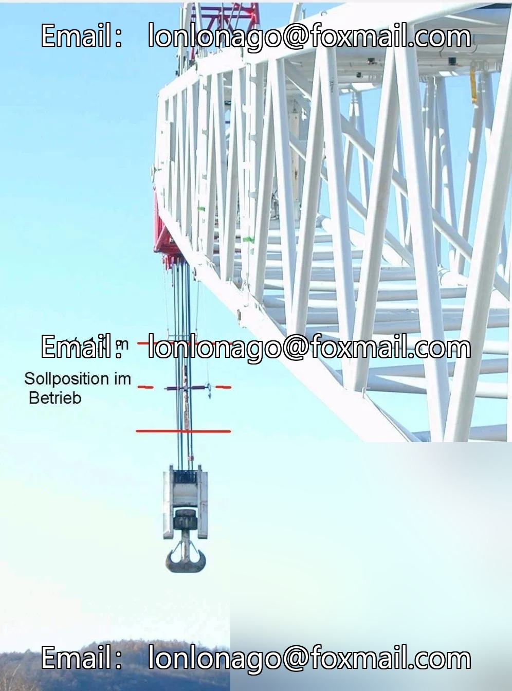
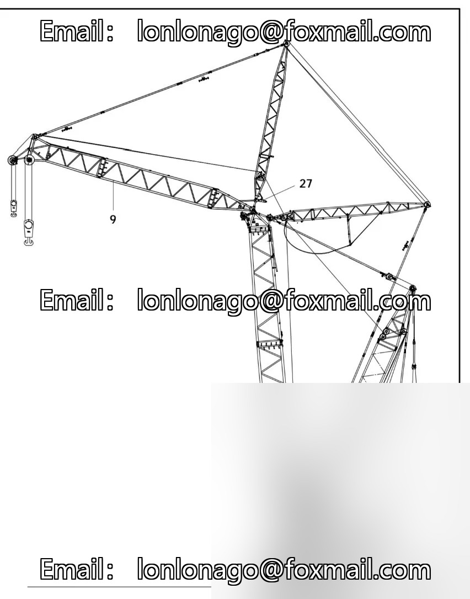
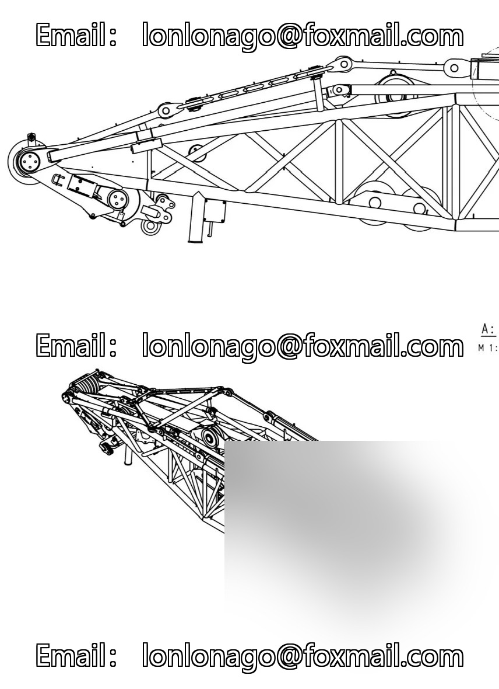
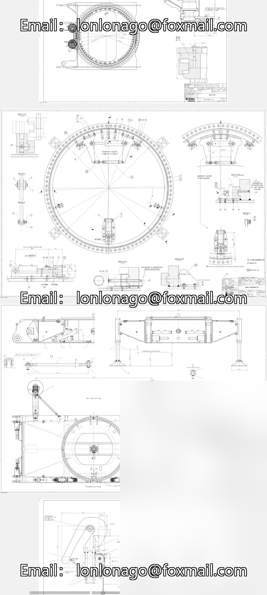
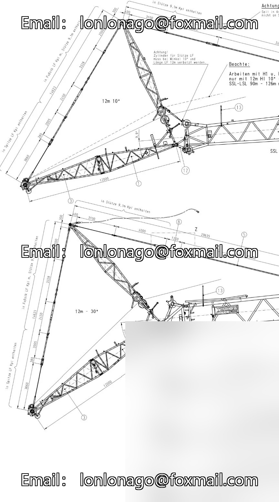
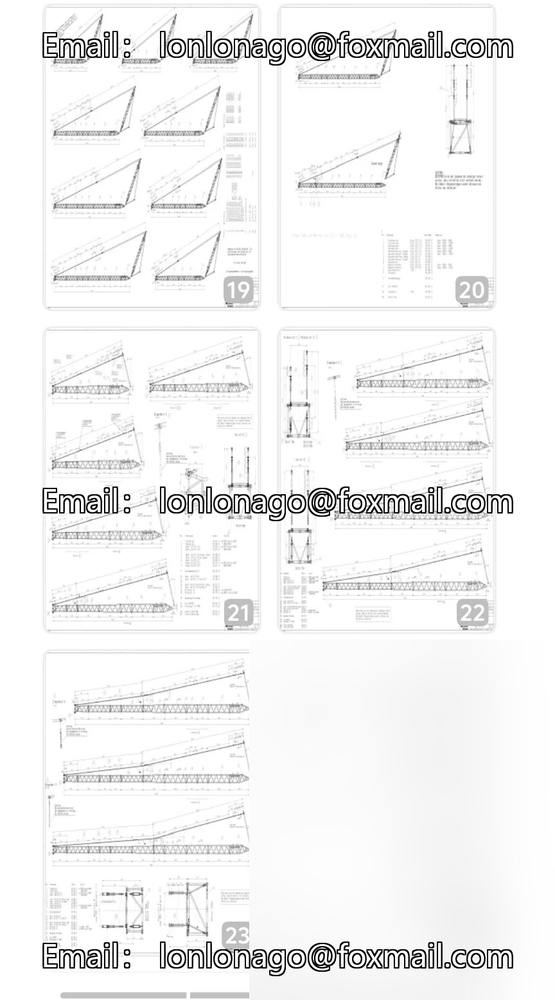

# Tracyx TEREX CC 2500-1 track crawler crane technical training hand

## Body

The technical training manual PDF of the TREx CC 2500-1 track-type crane, 2,300 pages, covering detailed technical parameters, structural design, operation processes, etc. of this crane model.
TREx (TEREX) CC 2500-1 is a classic track-type crane for large truss arms with a tonnage below 1,000 tons.
Large tonnage: The maximum rated load of this crane model usually reaches 500 tons, with the maximum lifting moment approximately 6,140 tons·meters, belonging to the main model in heavy track cranes.

Long main arm: The main arm can extend up to 126 meters, and with the combination of the secondary arm, the maximum work radius (working span) can reach about 146 meters, meeting the lifting requirements for high and large spaces.

Superlift configuration: supports the "Superlift" (superlift device), which can significantly enhance the hoisting capability and work flexibility of the main arm by altering the superlift radius and weight, which is one of its core advantages.
The data is in PDF format, suitable for professional learning, training, and reference usage related to construction machinery and lifting equipment.
are copyable, and they are non-refundable after sale.

The manual covers technical parameters, structural design and operating procedures for the Terex TEREX CC 2500-1 tractor crane; it is a PDF format suitable for engineering training and reference.

<!-- AI_ENRICHED -->

## Images

## Payment

Here is a pay link on Stripe ( https://buy.stripe.com/3cs8yP7sY87d0vu9AB ). Please contact me lonlonago@foxmail.com after funding $89, and I will send you a complete data files , thank you!

